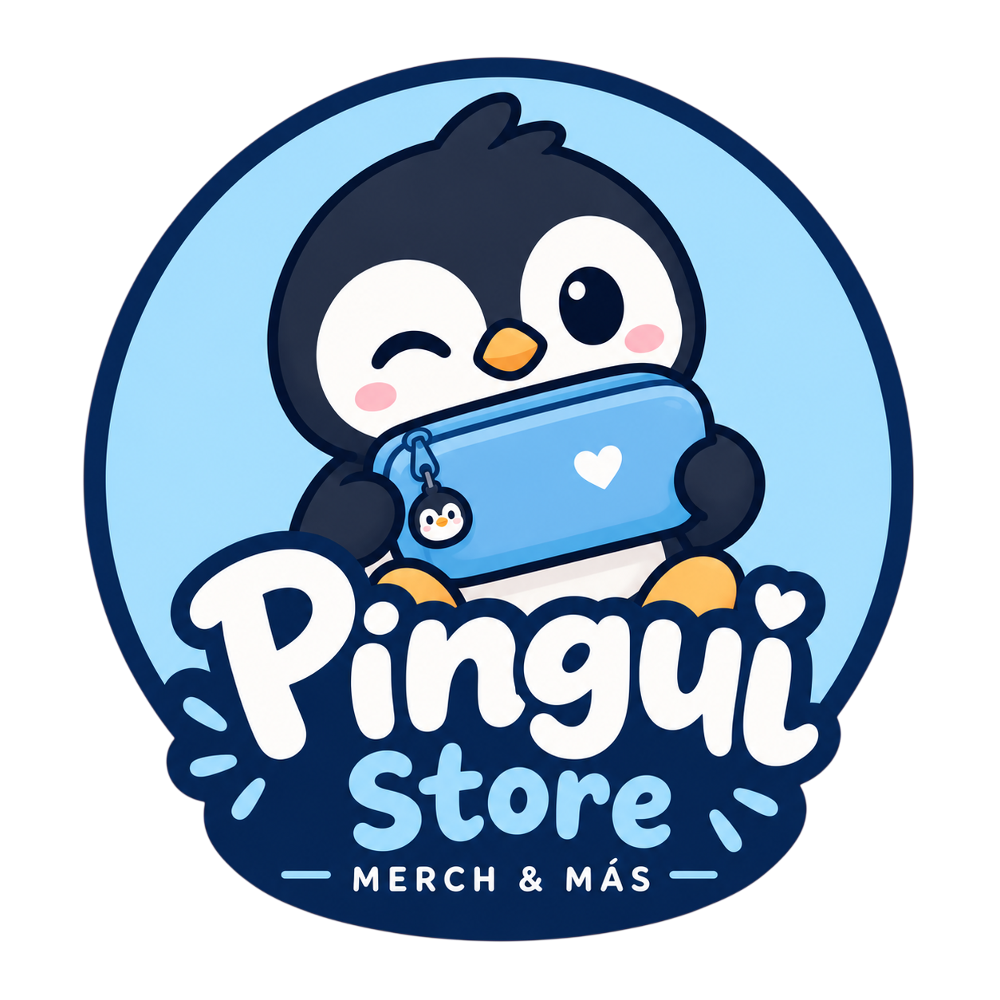
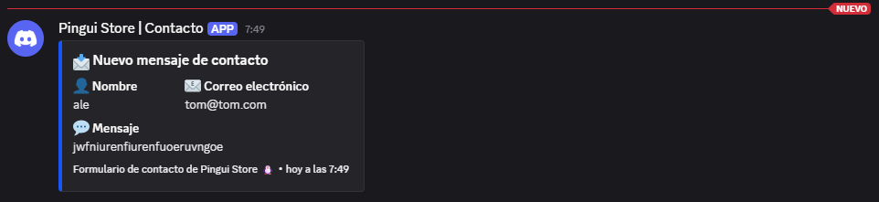
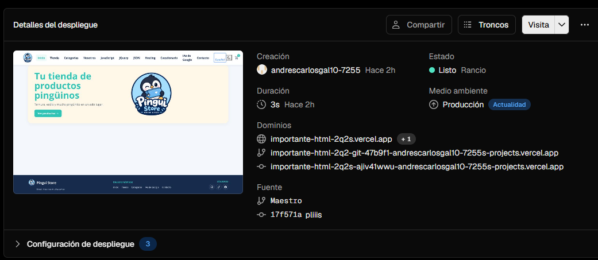
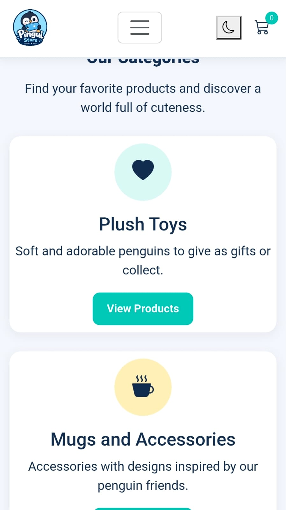
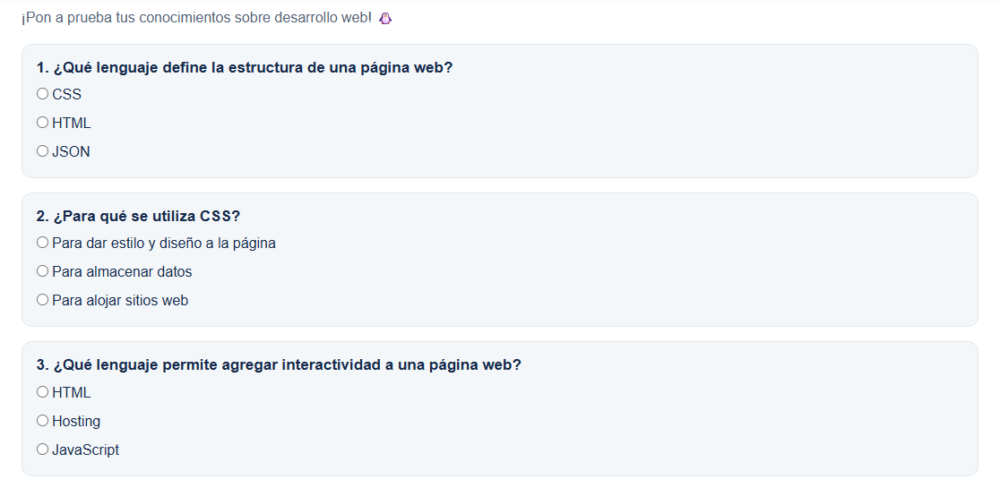
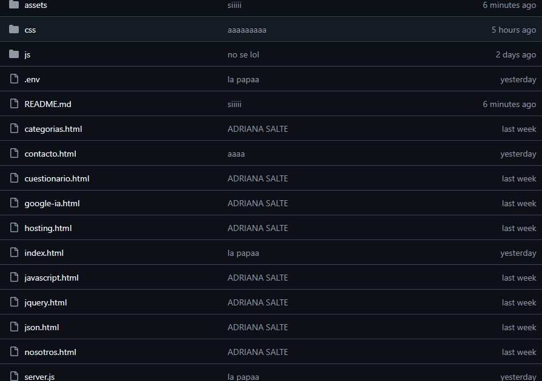

# 🐧 Portafolio de Proyecto Web: Pingui Store

**Estudiante:** [Carlos Andres Galdamez Cordova]  
**Fecha:** 22 de octubre de 2026  
**Enlace al Sitio Web (Vercel):** [https://importante-html-2q2s.vercel.app/index.html]  
**Repositorio GitHub:** [https://github.com/carlouuuus/importante-html]

---

## 1. Identidad de Marca y Producto

### 🐧 Ficha del Producto

- **Nombre Comercial:** Pingui Store.
- **Descripción:** Pingui Store es una tienda virtual dedicada a la venta de productos inspirados en pingüinos, como peluches, tazas, mochilas, llaveros y accesorios. Su propuesta de valor consiste en ofrecer artículos tiernos y atractivos mediante una página web moderna, interactiva y fácil de utilizar. El sitio permite explorar productos y utilizar funciones como el carrito de compras, los favoritos y la navegación por categorías.
- **Público Objetivo:** Jóvenes y personas que disfrutan de los pingüinos, los peluches, los accesorios originales y los productos tiernos. También está dirigida a quienes buscan regalos especiales para amigos y familiares.

### 🎨 Diseño Visual

**Logotipo de la marca:**



El logotipo representa la identidad de Pingui Store mediante la figura de un pingüino. Su diseño busca transmitir ternura, simpatía y cercanía con los visitantes de la tienda.

**Paleta de colores:**

| Color | Código HEX | Uso en el sitio |
|---|---|---|
| Azul principal | `#1769AA` | Navegación, elementos principales y botones. |
| Azul claro | `#DFF3FF` | Fondos suaves y elementos secundarios. |
| Azul oscuro | `#0D4775` | Contraste, títulos y detalles de la interfaz. |
| Turquesa | `#27E6E6` | Acentos y elementos destacados. |
| Rosa | `#EE3B74` | Detalles decorativos y elementos visuales. |
| Fondo claro | `#F8FBFF` | Fondo general de las páginas. |
| Texto | `#243447` | Textos y títulos para facilitar la lectura. |

**Demostración del carrusel de productos con Bootstrap:**


El carrusel de Bootstrap permite mostrar diferentes productos en varias diapositivas. Cuenta con controles de navegación e indicadores que facilitan recorrer los artículos de la tienda. Su diseño ayuda a presentar los productos de forma ordenada y atractiva.

---

## 2. Investigación Técnica

### 1. JavaScript (Vanilla)

JavaScript es un lenguaje de programación que permite añadir interactividad a las páginas web. Se utiliza para responder a las acciones del usuario, modificar elementos HTML y actualizar información sin recargar completamente la página.

En Pingui Store, JavaScript permite gestionar funciones como el carrito de compras, los productos favoritos, el cambio entre tema claro y oscuro, la búsqueda de productos y otras interacciones de la interfaz. También permite almacenar determinadas preferencias del usuario mediante `localStorage`.

### 2. jQuery

jQuery es una biblioteca de JavaScript que simplifica tareas como seleccionar elementos HTML, gestionar eventos y aplicar efectos visuales. Su sintaxis permite realizar ciertas operaciones con menos código.

La principal diferencia es que JavaScript es el lenguaje de programación, mientras que jQuery es una biblioteca construida sobre JavaScript. Ambas herramientas permiten trabajar con elementos de una página web, pero jQuery ofrece métodos específicos para facilitar algunas tareas.

### 3. JSON

JSON significa *JavaScript Object Notation*. Es un formato de texto utilizado para organizar e intercambiar datos entre aplicaciones y servidores. Su estructura se basa en pares de clave y valor, lo que permite representar información de manera ordenada.

Por ejemplo, los datos de un formulario pueden representarse así:

```json
{
  "nombre": "Ana",
  "correo": "ana@example.com",
  "asunto": "Consulta sobre productos",
  "mensaje": "Quisiera obtener más información."
}
```

En Pingui Store, JSON puede utilizarse para organizar los datos del formulario antes de enviarlos al servidor. También es útil para transferir información entre diferentes sistemas.

### 4. Web Hosting y Dominios

El hosting es un servicio que permite almacenar los archivos y recursos de un sitio web para que puedan consultarse por Internet. El dominio es la dirección que identifica al sitio, como `ejemplo.com`.

El DNS es el sistema que relaciona los nombres de dominio con los servidores correspondientes. Existen dominios genéricos, como `.com` y `.org`, y dominios territoriales, como `.sv`.

Vercel es una plataforma de despliegue que permite publicar sitios web y aplicaciones compatibles, conectándose con repositorios de GitHub para facilitar las actualizaciones. Para publicar Pingui Store, se debe comprobar que las rutas de los archivos y la configuración sean correctas.

Si se utiliza Node.js para procesar el formulario y enviarlo a Discord, también es necesario desplegar ese backend en un servicio compatible o adaptar la integración a una función de servidor compatible con la plataforma. Publicar únicamente los archivos HTML, CSS y JavaScript no hace que un servidor local funcione automáticamente en Internet.

---

## 3. Integraciones Especiales

### 📨 Formulario de Contacto + Webhook de Discord

El formulario de contacto de Pingui Store está diseñado para permitir que los visitantes envíen consultas relacionadas con los productos de la tienda. Incluye campos para introducir el nombre, el correo electrónico, el asunto y el mensaje.

**Funcionamiento técnico:**

1. El usuario completa los campos del formulario de contacto.
2. JavaScript recoge los datos y prepara la información para su envío.
3. Se realiza una petición asíncrona mediante `fetch()` hacia el servidor de Pingui Store.
4. El servidor recibe y valida los datos del formulario.
5. El servidor realiza una petición HTTP `POST` al webhook de Discord, utilizando la dirección privada almacenada en una variable de entorno.
6. Discord recibe la notificación en el canal asociado al webhook.
7. La página muestra un mensaje que informa si el envío fue exitoso o si ocurrió algún error.

**Tecnologías utilizadas:**

- HTML para estructurar el formulario.
- CSS y Bootstrap para diseñar la interfaz.
- JavaScript para gestionar el envío asíncrono.
- Node.js y Express para crear el servidor.
- dotenv para administrar variables de entorno.
- Discord Webhooks para recibir las notificaciones.

**Seguridad:** El enlace del webhook debe mantenerse privado y no debe colocarse directamente en el HTML ni en el JavaScript que se ejecuta en el navegador. El servidor debe validar los datos y protegerse contra envíos abusivos.

**Estado de la integración:** Se debe comprobar el envío real del formulario y la recepción del mensaje en Discord antes de presentar esta función como finalizada.

---

## 4. Anexos y Evidencias Gráficas

En esta sección se presentan las cinco evidencias solicitadas para demostrar el diseño, el funcionamiento y la publicación de Pingui Store.

### 📸 Anexo 1. Integración con Discord: formulario y recepción

**Descripción:** Captura combinada que muestra el formulario de contacto de Pingui Store con datos de prueba y la notificación correspondiente recibida en el canal de Discord.



### 📸 Anexo 2. Despliegue exitoso en Vercel

**Descripción:** Captura del panel de control de Vercel donde se visualiza el proyecto publicado, su estado de despliegue y la dirección pública del sitio web.



### 📸 Anexo 3. Diseño responsive y Bootstrap

**Descripción:** Captura del sitio web en vista móvil mediante las herramientas de desarrollador del navegador. Debe mostrar cómo se adaptan el menú de navegación, las tarjetas y la distribución de los elementos a una pantalla pequeña.



### 📸 Anexo 4. Cuestionario interactivo en funcionamiento

**Descripción:** Captura del cuestionario de conocimientos web con preguntas respondidas y elementos interactivos visibles. Esta evidencia permite demostrar el funcionamiento del módulo de autoevaluación.



### 📸 Anexo 5. Estructura del repositorio en GitHub

**Descripción:** Captura de la página principal del repositorio público de GitHub donde se observa la organización de los archivos y carpetas principales del proyecto.



**Nota:** Las imágenes anteriores son referencias a los archivos que deben guardarse en la carpeta `assets`. Para que aparezcan correctamente en GitHub, es necesario crear las capturas reales, guardarlas con esos nombres o modificar las rutas para que coincidan con los nombres utilizados.

---

## 5. Conclusiones y Autoevaluación

### Desafíos enfrentados

Durante el desarrollo de Pingui Store, uno de los principales desafíos fue organizar las diferentes páginas del sitio y mantener un diseño visual consistente. También fue necesario trabajar con Bootstrap para crear componentes como el carrusel de productos y conseguir una distribución adaptable a diferentes tamaños de pantalla.

Otro desafío fue implementar funciones interactivas mediante JavaScript, como el carrito de compras, los favoritos, el cambio de tema y el selector de idioma. Asimismo, la integración del formulario con Discord requiere comprender cómo se comunican el navegador, un servidor y un servicio externo.

### Aprendizajes clave

El desarrollo de Pingui Store me permitió reforzar mis conocimientos de HTML, CSS, JavaScript y Bootstrap. También me ayudó a comprender mejor el funcionamiento de jQuery, JSON, los dominios, el hosting y las plataformas de despliegue.

Aprendí la importancia de organizar los archivos, diseñar interfaces fáciles de utilizar, comprobar el funcionamiento de las características interactivas y validar los datos que se envían desde un formulario. Además, comprendí que las credenciales privadas deben mantenerse protegidas y que las integraciones con servicios externos necesitan una configuración correcta del servidor.

En conclusión, Pingui Store me permitió combinar diseño web, programación e investigación técnica en un proyecto que reúne una identidad de marca, una tienda virtual y diferentes recursos interactivos.

---

## 6. Rúbrica de Evaluación

La siguiente tabla resume los criterios establecidos en la guía del proyecto.

| Criterio de evaluación | Descripción | Ponderación |
|---|---|---:|
| Branding y producto | Identidad de marca, logotipo, paleta de colores y carrusel funcional. | 15 % |
| Investigación técnica | Calidad y claridad de las páginas sobre JavaScript, jQuery, JSON, hosting y dominios. | 25 % |
| Integración con Discord | Formulario funcional con envío asíncrono y recepción de notificaciones mediante webhook. | 15 % |
| Cuestionario interactivo | Módulo de autoevaluación con entre 5 y 10 preguntas de repaso teórico. | 15 % |
| Portafolio en Markdown | README completo con la documentación y las cinco evidencias obligatorias. | 20 % |
| Publicación y Git | Repositorio público organizado, commits claros y despliegue funcional. | 10 % |
| **Total** | | **100 %** |

---

## 7. Forma de Entrega en Google Classroom

Para realizar la entrega formal del proyecto en Google Classroom, se deben adjuntar los siguientes dos enlaces:

1. **Sitio web publicado en Vercel:** [Pegar aquí la URL pública real de Pingui Store].
2. **Repositorio público en GitHub:** [Pegar aquí la URL real del repositorio].

Antes de entregar, es necesario verificar que el sitio web esté accesible, que el repositorio sea público, que el archivo `README.md` incluya la documentación y las cinco capturas solicitadas, y que las funciones descritas estén comprobadas.

**Recordatorio final:** La documentación del proyecto debe estar alojada en el archivo `README.md` del repositorio de GitHub. Según la guía, no se deben entregar archivos adjuntos en Word ni PDF.
